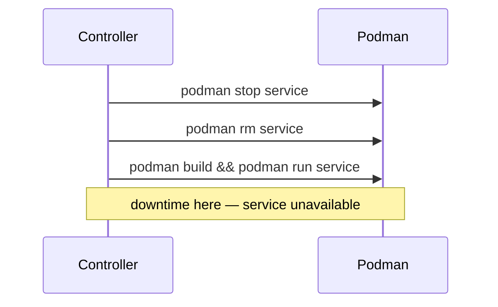
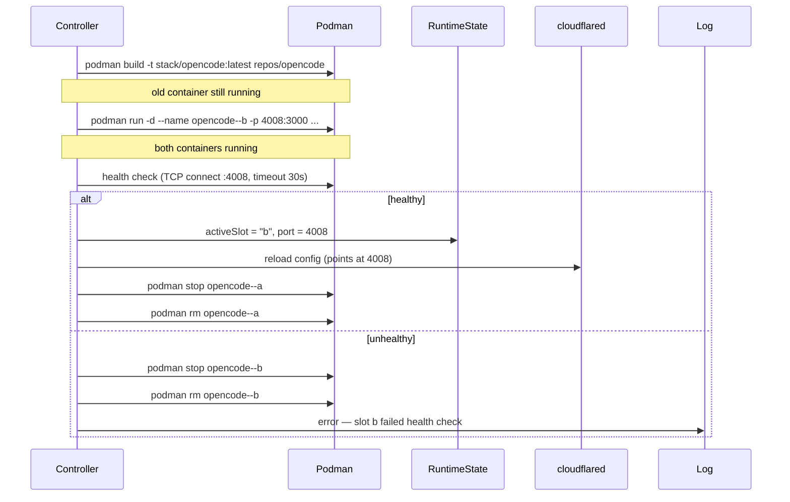

# Slot-Based Container Restarts (Blue-Green Deploy)

## Goal

Zero-downtime container updates. When a service's source changes, build and
start the new container before stopping the old one, then swap traffic.

## Current Problem



The old process: **stop → remove → build → run**. The service dies before the
new one is ready.

## Slot Architecture

Each container service gets two slots. One is *active* (serving traffic), the
other is *idle*.

```
Container names:
  opencode--a   ← active (port 4007)
  opencode--b   ← idle   (port 4008)
```

### Runtime State

The existing `runtime/services.json` gains per-slot tracking:

```json
{
  "opencode": {
    "activeSlot": "a",
    "slots": {
      "a": { "port": 4007, "running": true },
      "b": { "port": 4008, "running": false }
    },
    "port": 4007,
    "running": true
  }
}
```

The top-level `port` field (used by the `/proxy/:name` endpoint and
cloudflared ingress config) always points at the active slot.

## Swap Sequence

```
hash changed → build new image → start idle slot → health check → swap
```



## Cloudflared Config Reload (Option 2)

The question: how do we point cloudflared at the new port without dropping
the tunnel?

### Current behavior

`writeCloudflaredConfig` writes `/etc/cloudflared/config.yml` and calls:

```bash
sudo -n systemctl restart cloudflared
```

`Type=notify` in the systemd unit means cloudflared tells systemd when it's
ready. The sequence:

1. Old cloudflared is serving
2. New cloudflared starts, connects to edge, sends `READY=1`
3. Systemd sends `SIGTERM` to old cloudflared
4. Old cloudflared is given a grace period (default 90s) to drain
5. If it doesn't exit, `SIGKILL`

The Cloudflare edge maintains QUIC/HTTP2 connections and can buffer traffic
briefly while the new connector registers. In practice this is usually
transparent to clients. However, it is not *guaranteed* zero-downtime.

### Cloudflared reload capability

Cloudflared 2026.3.0 does not expose a `reload` or `config update` subcommand.
It does not respond to `SIGHUP` for config reload.

Available options:

| Method | Downtime | Complexity |
|--------|----------|------------|
| `systemctl restart cloudflared` | ~1-2s (edge buffers) | Low — already works |
| SIGHUP to process | Not supported in this version | N/A |
| Route through controller proxy | Zero (no config change needed) | Medium |

### Recommended: Route through the controller proxy

Instead of pointing cloudflared at individual service ports, point it at a
dedicated **slot-proxy** container. The proxy reads `runtime/services.json`
once at startup, then uses `fs.watch` to keep its in-memory cache fresh.
No disk reads per-request during steady state.

**Implemented at `repos/slot-proxy/`:**
```
repos/slot-proxy/
├── agent-stack.json   # port: 80, auto_port: true
├── Containerfile      # node:22-alpine, 2 lines
└── proxy.mjs          # 60 lines, fs.watch cache, WebSocket upgrade
```

The proxy is a managed container like any other — the controller builds it,
runs it, and injects `IS_CONTAINER=true`. It mounts the runtime directory:

```json
"volumes": ["/srv/agent-stack/runtime:/runtime"]
```

**Then cloudflared config never changes during a swap.** It points at the
proxy once:

```yaml
# /etc/cloudflared/config.yml — set once, never changes during swaps
tunnel: ca308a1b-557a-4a18-9350-6eec27465bdf
ingress:
  - hostname: opencode.ffilt.us
    service: http://127.0.0.1:<proxy-port>/proxy/opencode
  - hostname: *.ffilt.us
    service: http://127.0.0.1:<proxy-port>/proxy/no-service
  - service: http_status:404
```

The proxy routes `/proxy/:name/*` to the active slot's port. When a swap
happens, the controller updates `services.json`, the watcher fires, the
proxy's cache is updated — and the next request goes to the new slot.

### Alternative: Accept the restart blip

If the extra proxy hop is undesirable, keep the current direct-ingress model.
`systemctl restart cloudflared` with `Type=notify` is typically <2s, and the
Cloudflare edge handles reconnection transparently. For personal/internal
services this is fine — just document that restarts cause a brief blip.

## Implementation Plan

### Phase 1: Config + Types

**`lib/config.ts`**
```ts
export const SLOTS = ["a", "b"] as const;
export const HEALTH_CHECK_TIMEOUT = 30_000;
export function slotContainerName(base: string, slot: string): string {
  return `${base}--${slot}`;
}
export function slotOf(containerName: string): string | null {
  const m = containerName.match(/--([ab])$/);
  return m ? m[1] : null;
}
```

**`lib/types.ts`** — add slot state tracking
```ts
export interface SlotState {
  port: number;
  running: boolean;
}
```

### Phase 2: Slot-Aware Runtime State

**`lib/runtime.ts`** — write per-slot state
```ts
state[s.name] = {
  activeSlot: "a",
  slots: {
    a: { port: portA, running: containerRunning(`${s.name}--a`) },
    b: { port: portB, running: containerRunning(`${s.name}--b`) },
  },
  port: activePort,
  // ... existing fields
};
```

### Phase 3: Idle Detection

**`lib/reconcile.ts`** — helper to find the slot NOT currently active
```ts
function idleSlot(service: Service): string {
  const runtime = loadRuntimeState();
  const current = runtime[service.name]?.activeSlot || "a";
  return current === "a" ? "b" : "a";
}
```

### Phase 4: Port Allocation Per-Slot

**`lib/reconcile.ts`** — `allocatePort` with slot awareness

- Each slot needs its own host port
- The idle slot gets the next available port
- On swap, the old slot's port is freed
- Always allocate 2 ports per service (or lazily on first deploy)

### Phase 5: Container Management

**`lib/podman.ts`** — `runContainer` accepts explicit name + port
```ts
export function runContainer(
  service: Service,
  allServices: Service[],
  opts?: { containerName?: string; hostPort?: number }
): void
```

### Phase 6: Health Check

**`lib/podman.ts`** — wait for container to respond
```ts
export function waitForHealthy(
  containerName: string,
  port: number,
  timeout: number
): boolean
```

Strategy:
1. Wait for `containerRunning(containerName)` to be true (max 10s)
2. TCP connect to `127.0.0.1:<port>` (max 30s total)
3. If the service config defines an `health_check_path`, GET it and check 2xx
4. Return `true` if all pass within timeout

### Phase 7: Rewrite ensureContainer

**`lib/reconcile.ts`** — slot-based flow replacing the current recreate path:

```
ensureContainer(service):
  if first deploy:
    allocatePort(slot a)
    runContainer(slot a)
    mark active = a
    return

  if hash changed:
    build new image
    if build fails → backoff (existing logic)

    idle = opposite of active slot
    idlePort = allocate port for idle slot

    runContainer(service, { containerName: service--idle, hostPort: idlePort })

    if waitForHealthy(service--idle, idlePort):
      // Swap
      runtime.activeSlot = idle
      runtime.slots[idle].port = idlePort
      runtime.port = idlePort
      writeRuntimeState()

      stop + remove service--active
      runtime.slots[active].running = false
      writeRuntimeState()
    else:
      stop + remove service--idle
      log error — health check failed
      return  // old container stays active
```

### Phase 8: Proxy Routing

No code changes needed. The existing `/proxy/:name` handler reads
`runtime[name].port`, which after a swap points at the new slot.

If using direct cloudflared ingress (no proxy), `writeCloudflaredConfig`
must be called after the swap to update the port in the YAML. With
`Type=notify`, the tunnel restart is <2s.

## Edge Cases

| Case | Behavior |
|------|----------|
| **First deploy** | Slot `a` is started, marked active. No slot `b` yet. |
| **System restart** | Runtime state is read from disk. Active slot detected, idle slot verified. |
| **Health check fails** | Idle container is cleaned up. Old container keeps serving. Error surfaces in reconcile errors. |
| **Both slots dead** | Same as current: both containers are stopped. Next reconcile tries to start one from scratch. |
| **Manual slot pinning** | Service config allows `slot: "a"` to force a specific slot for debugging. |
| **Rollback** | Deploying an older config produces a new hash, triggering the same swap flow in reverse. |
| **Build succeeds, start fails** | Old slot stays. Build error surfaces as normal. |

## Risks

- **Build time** — Building a new image on the slow path delays the
  reconciliation tick for that service. The worker runs every 5s regardless,
  so other services are unaffected.
- **Port exhaustion** — Two ports per service instead of one doubles the
  range pressure. The auto-port range (4000–4999) supports ~500 services
  instead of ~1000. For a dozen services this is irrelevant.
- **Health check false negative** — A service that starts slowly could be
  killed prematurely. Mitigation: 30s timeout + configurable per-service.
